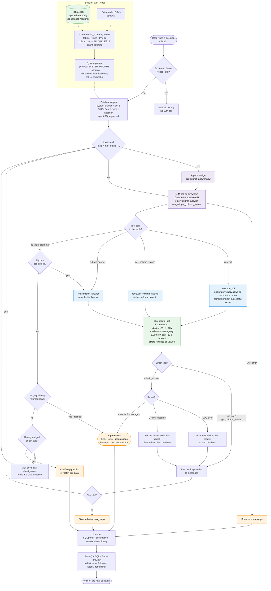
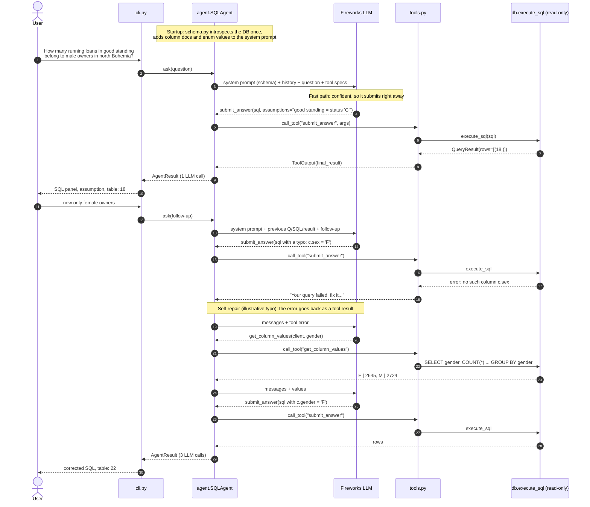
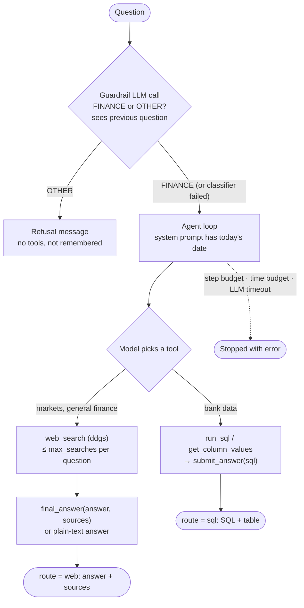

# How the agent works

Two views of the same system. The Mermaid source is in [diagrams/](diagrams/) and renders on
GitHub. PNG and SVG exports are next to it for slides or offline viewing
([flow PNG](diagrams/agent_flow.png), [sequence PNG](diagrams/agent_sequence.png)).

## 1. Control flow of one question

The whole loop lives in `SQLAgent.ask()` ([src/agent.py](../src/agent.py)). Every query, from any
tool, goes through the single read-only executor in [src/db.py](../src/db.py) (green box).

### Reading the diagram

| Stage | Where | What happens | Why |
|---|---|---|---|
| Session start | `schema.build_schema_context` | Introspect tables, types, keys; merge the doc CSVs; list every value of low-cardinality text columns | Stops hallucinated names and wrong filter values (e.g. `'south Moravia'`, loan status `'C'`) |
| Build messages | `SQLAgent.ask` | System prompt + last 5 question/SQL/result-preview pairs + the new question | Follow-ups ("now only women") can edit the previous SQL; prompt stays small |
| LLM call | `SQLAgent._call_llm` | OpenAI-compatible call to Fireworks with 3 tool specs, temperature 0 | One API shape for any Fireworks model; `--model` switches it |
| Exploration | `tools.run_sql`, `tools.get_column_values` | Model checks data or values before answering; rows go back to the model only | Lets the model verify when unsure, without the user seeing scratch work |
| Final answer | `tools.submit_answer` | Executes the final SQL. An error or a first empty result goes back to the model | Self-repair: broken SQL is fixed before the user sees it |
| Safety | `db.execute_sql` | One `SELECT`/`WITH` statement, `mode=ro` + `query_only`, 1,000-row cap, 10s timeout, errors returned as values | Model output is untrusted; the database can't be modified |
| Stop conditions | `SQLAgent.ask` | (1) a terminal tool ends the turn (`submit_answer` accepted, or a terminal tool returns a reply for the user), (2) plain-text reply (asked once to call `submit_answer` instead, so a data answer always comes with SQL; a real clarifying question comes back as text again), (3) `max_steps` reached (the last step adds a "submit now" nudge), (4) API error | Bounded latency and cost per question |
| Fallbacks | `SQLAgent.ask` | SQL in a code block → executed as a submit. Prose after a successful `run_sql` → that result is used | Some models (gpt-oss-120b) skip the final tool call: 8/10 → 10/10 |
| Output | `cli.render`, `AgentResult` | SQL panel, assumptions, results table, latency, LLM calls, tokens. `/trace` shows each step | Trust: users can check the SQL and the interpretation |

The happy path is **one LLM call**: the model calls `submit_answer` straight away and the results
are rendered directly, with no second call to phrase them. Over 30 runs, Kimi K3 averaged 1.03 calls
per question and gpt-oss-120b averaged 1.5.

## 2. A concrete session

The first question takes the fast path. The follow-up shows the repair loop. The `c.sex` typo
was made up to illustrate it; the gender counts and the final answers (18 and 22) are the real
values in the database.

## Where to extend it (Stage 2)

* **New tool:** write `handler(ctx, **args) -> ToolOutput` and add a `Tool(...)` entry in
  `build_tools()` ([src/tools.py](../src/tools.py)). Only `terminal=True` tools can end the turn, and
  they do it by returning `final_result` (an accepted query) or `final_message` (a reply such as a
  clarifying question). The loop doesn't change.
* **Routing:** `_call_llm` is the single place where model choice happens. A router (a cheap model for easy
  questions, a stronger one for hard ones) goes there.
* **Load testing:** the `AgentResult` timings (`latency_s`, `llm_s`, `llm_calls`, tokens) are what
  a concurrent load harness would aggregate. `src/evaluate.py` already reports P50/P95.

## 3. Finance assistant: guardrail and two sources

Added after the take-home. A guardrail call runs before the loop above, and two web tools join the
same tool list. The loop itself is unchanged apart from the time budget and treating a plain-text
reply after a search as the answer. (The PNG/SVG exports above predate this section.)

